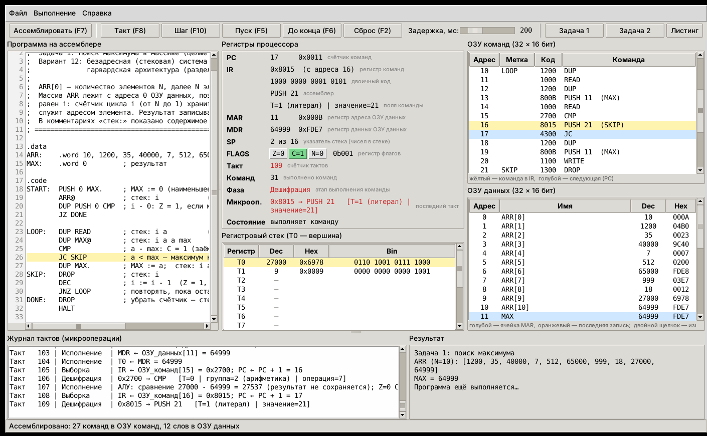

# Эмулятор безадресного стекового процессора — вариант 12

| Параметр | Значение |
|---|---|
| Адресность | безадресная (стековая машина, как Forth-процессор из методички) |
| Архитектура | гарвардская: отдельные ОЗУ команд и ОЗУ данных |
| Задание 1 | поиск максимума в массиве |
| Задание 2 | свёртка двух массивов, 6 элементов, целые числа без знака |



---

## 1. Запуск

### Что нужно
Только **Python 3.8 или новее**. Сторонние библиотеки не нужны: интерфейс сделан на `tkinter`, он входит в Python.

- **Windows.** Скачайте Python с <https://www.python.org/downloads/>. В установщике поставьте галочку **Add python.exe to PATH**. Пункт **tcl/tk and IDLE** включён по умолчанию, его не снимайте.
- **macOS.** Установщик с python.org уже содержит tkinter.
- **Linux (Ubuntu/Debian).** `sudo apt install python3 python3-tk`

### Запуск графического интерфейса
Откройте терминал (в Windows — «Командная строка» или PowerShell) в папке `emulator` и выполните:

```bash
python main.py
```

В Windows вместо `python` можно писать `py`. Ещё можно дважды щёлкнуть по `main.py`.

Откроется окно с загруженным примером «Задача 1». Сразу открыть нужный файл:

```bash
python main.py programs/task2_convolution.asm
```

### Запуск без графического интерфейса (консоль)
```bash
python main.py --run programs/task1_max.asm          # выполнить и показать результат
python main.py --listing programs/task2_convolution.asm   # машинный код (листинг)
```

### Автотесты
```bash
python -m unittest discover -s tests -v
```
47 тестов проверяют систему команд, ассемблер, каждую команду процессора и флаги. Обе задачи прогоняются на 300 случайных массивах каждая и на граничных случаях. Если tkinter есть, тестируется ещё и графический интерфейс.

---

## 2. Как пользоваться

### Области окна
| Область | Что показывает |
|---|---|
| **Программа на ассемблере** (слева) | редактор текста программы; жёлтым выделена строка команды, которая сейчас в IR; при ошибке ассемблирования строка подсвечивается розовым |
| **Регистры процессора** | PC, IR (hex, двоичный вид, ассемблер, поля команды), MAR, MDR, SP, флаги Z/C/N, счётчик тактов и команд, фаза такта и микрооперация. Красным выделяется то, что изменилось на последнем такте |
| **Регистровый стек** | T0 (вершина) … T15 в десятичном, шестнадцатеричном и двоичном виде |
| **ОЗУ команд** | 32 слова программы: адрес, метка, машинный код, команда. Жёлтым выделена команда в IR, голубым — следующая (PC) |
| **ОЗУ данных** | 32 слова данных с именами переменных (`ARR[0]`, `MAX` …). Голубым выделена ячейка по адресу MAR, оранжевым — последняя запись |
| **Журнал тактов** | все выполненные микрооперации по тактам |
| **Результат** | массивы, ответ и автоматическая проверка (ответ эмулятора сравнивается с вычислением на Python) |

### Кнопки и клавиши
| Кнопка | Клавиша | Действие |
|---|---|---|
| Ассемблировать | F7 | перевести текст в машинные коды и загрузить в ОЗУ команд и ОЗУ данных |
| Такт | F8 | выполнить **один такт** (выборка, дешифрация или одна микрооперация исполнения) |
| Шаг | F10 | выполнить **одну команду** целиком |
| Пуск / Стоп | F5 | автоматическое выполнение по командам с задержкой (ползунок «Задержка, мс») |
| До конца | F6 | выполнить программу до `HALT` сразу |
| Сброс | F2 | обнулить регистры и заново загрузить обе памяти из программы |
| Задача 1 / Задача 2 | — | открыть готовую программу |
| Листинг | — | машинный код программы: адрес, hex, двоичный код, команда. Можно сохранить в файл для отчёта |
| Справка | F1 | описание всех команд, формата команды, флагов, синтаксиса ассемблера и регистров |

Меню **Файл**: открыть, сохранить (`Ctrl+O`, `Ctrl+S`) и примеры.

### Сценарий демонстрации
1. Нажмите **Задача 1**: программа загрузится и ассемблируется.
2. Нажимайте **Такт (F8)**. Видно, как идут такты:
   *выборка* (`IR ← ОЗУ_команд[PC]`, `PC ← PC+1`) → *дешифрация* (поля IR) → *исполнение*.
   На командах `READ`/`WRITE` видно работу MAR и MDR.
3. Нажимайте **Шаг (F10)**, чтобы выполнять команды целиком. По стеку видно, как числа кладутся и снимаются.
4. Нажмите **Пуск (F5)**, чтобы программа выполнялась сама, или **До конца (F6)**.
5. В панели **Результат** появится `MAX = 65000` и «Проверка … — ВЕРНО».
6. **Сброс (F2)** вернёт всё в начальное состояние.
7. То же самое с **Задачей 2** (свёртка).

### Как поменять входные массивы
- **В тексте программы:** измените строку `.word` в секции `.data`. Первое число — длина массива. Затем нажмите **Ассемблировать**. Массив `ARR` (задача 1) и массив `A` (задача 2) должны оставаться первыми в секции `.data`, то есть начинаться с адреса 0 — на этом построены программы (см. раздел 6).
- **Прямо в памяти:** дважды щёлкните по ячейке ОЗУ данных и введите новое значение (0 … 65535). При «Сбросе» память снова заполнится значениями из текста программы.

Если текст программы изменён, при нажатии «Такт», «Шаг» или «Пуск» программа ассемблируется заново автоматически.

---

## 3. Архитектура процессора

### Эмулируемые компоненты
| Компонент | Размер | Назначение |
|---|---|---|
| ОЗУ команд | 32 × 16 бит | программа (по одной команде в ячейке) |
| ОЗУ данных | 32 × 16 бит | массивы и переменные |
| PC | 16 бит | счётчик команд: адрес следующей команды в ОЗУ команд |
| IR | 16 бит | регистр команд: текущая команда |
| MAR | 16 бит | регистр адреса ОЗУ данных |
| MDR | 16 бит | регистр данных ОЗУ данных |
| Стек T0…T15 | 16 × 16 бит | регистровый стек, T0 — вершина; в нём находятся операнды всех команд |
| SP | 0 … 16 | указатель стека = количество чисел в стеке |
| FLAGS | 3 бита | бит 2 — **N**, бит 1 — **Z**, бит 0 — **C** |

**Гарвардская архитектура.** Команды и данные лежат в разных памятях, у каждой своя шина. Адрес 0 в ОЗУ команд и адрес 0 в ОЗУ данных — это разные ячейки. Память команд адресуется через PC, слово из неё попадает в IR. К памяти данных обращаются только команды `READ` и `WRITE`, через MAR и MDR.

**Безадресная машина.** В командах нет адресных полей. Операнды и результат находятся в стеке. Адрес для `READ`/`WRITE` и адрес перехода тоже берутся с вершины стека.

### Такты выполнения команды
1. **Выборка:** `IR ← ОЗУ_команд[PC]`, `PC ← PC + 1`
2. **Дешифрация:** разбор полей IR, проверка, что в стеке хватает операндов и не будет переполнения
3. **Исполнение:** 1 такт; у `READ` и `WRITE` 3 такта:
   - `READ`: `MAR ← T0` → `MDR ← ОЗУ[MAR]` → `T0 ← MDR`
   - `WRITE`: `MAR ← T0` → `MDR ← T1` → `ОЗУ[MAR] ← MDR`

### Флаги
- **Z** — результат равен нулю.
- **C** — перенос при сложении (`ADD`, `ADC`, `INC`) или заём при вычитании (`SUB`, `SBB`, `DEC`, `CMP`). Для сдвигов — выдвинутый бит. Для `UMUL` C = 1, если старшее слово произведения не равно 0.
- **N** — 15-й (старший) бит результата.

Флаги меняют **только** арифметические и логические команды. `PUSH`, `READ`, `WRITE`, `DUP`, `SWAP` и т. п., а также переходы флаги не трогают. Поэтому между `ADD` и `ADC` можно сохранять и читать переменные, и перенос не теряется.

---

## 4. Система команд

### Формат команды (16 бит, фиксированная длина)
```
Литерал (PUSH n):   бит 15 = 1 | биты 14..0 = n (0 … 32767)

Прочие команды:     бит 15 = 0 | биты 14..12 = группа | биты 11..8 = операция | биты 7..0 = 0
```
Группы: 0 — управление, 1 — пересылка и стек, 2 — арифметика, 3 — логика и сдвиги, 4 — переходы.

Примеры: `PUSH 5` = `1000 0000 0000 0101` = `0x8005`; `ADD` = `0010 0000 0000 0000` = `0x2000`.

### Команды
Стековая нотация `( до -- после )`: справа вершина стека. Для бинарных операций `a = T1`, `b = T0`.
«Тактов» — полное число тактов: выборка + дешифрация + исполнение.

| Команда | Код (hex) | Стек: до -- после | Флаги | Тактов | Описание |
|---|---|---|---|---|---|
| `PUSH n` | 8000 + n | `( -- n )` | — | 3 | Литерал: положить в стек число n (0 … 32767) или адрес метки |
| `HALT` | 0000 | `( -- )` | — | 3 | Останов процессора |
| `NOP` | 0100 | `( -- )` | — | 3 | Нет операции |
| `READ` | 1000 | `( адр -- знач )` | — | 5 | Чтение ОЗУ данных: MAR ← T0, MDR ← ОЗУ[MAR], T0 ← MDR |
| `WRITE` | 1100 | `( знач адр -- )` | — | 5 | Запись в ОЗУ данных: MAR ← T0, MDR ← T1, ОЗУ[MAR] ← MDR |
| `DUP` | 1200 | `( a -- a a )` | — | 3 | Дублировать вершину стека |
| `DROP` | 1300 | `( a -- )` | — | 3 | Удалить вершину стека |
| `SWAP` | 1400 | `( a b -- b a )` | — | 3 | Поменять местами два верхних числа |
| `OVER` | 1500 | `( a b -- a b a )` | — | 3 | Скопировать второе число на вершину |
| `ROR` | 1600 | `( a b c -- b c a )` | — | 3 | Вращение трёх верхних чисел: третье число переходит на вершину |
| `ROL` | 1700 | `( a b c -- c a b )` | — | 3 | Вращение трёх верхних чисел: вершина переходит на место третьего |
| `ADD` | 2000 | `( a b -- a+b )` | Z C N | 3 | Сложение; C — перенос из 15-го разряда |
| `ADC` | 2100 | `( a b -- a+b+C )` | Z C N | 3 | Сложение с переносом (длинная арифметика) |
| `SUB` | 2200 | `( a b -- a-b )` | Z C N | 3 | Вычитание; C — заём (a < b) |
| `SBB` | 2300 | `( a b -- a-b-C )` | Z C N | 3 | Вычитание с заёмом (длинная арифметика) |
| `INC` | 2400 | `( a -- a+1 )` | Z C N | 3 | Инкремент; C — перенос |
| `DEC` | 2500 | `( a -- a-1 )` | Z C N | 3 | Декремент; C — заём |
| `UMUL` | 2600 | `( a b -- мл ст )` | Z C N | 3 | Умножение без знака 16×16 → 32 бита: T0 — старшее слово, T1 — младшее; C = 1, если старшее слово ≠ 0 |
| `CMP` | 2700 | `( a b -- )` | Z C N | 3 | Сравнение: a-b только для флагов, оба числа снимаются; C = 1, если a < b |
| `AND` | 3000 | `( a b -- a&b )` | Z C N | 3 | Побитовое И; C = 0 |
| `OR` | 3100 | `( a b -- a\|b )` | Z C N | 3 | Побитовое ИЛИ; C = 0 |
| `XOR` | 3200 | `( a b -- a^b )` | Z C N | 3 | Побитовое исключающее ИЛИ; C = 0 |
| `NOT` | 3300 | `( a -- ~a )` | Z C N | 3 | Побитовая инверсия; C = 0 |
| `SHL` | 3400 | `( a -- a<<1 )` | Z C N | 3 | Логический сдвиг влево; C — выдвинутый 15-й бит |
| `SHR` | 3500 | `( a -- a>>1 )` | Z C N | 3 | Логический сдвиг вправо; C — выдвинутый 0-й бит |
| `JMP` | 4000 | `( адр -- )` | — | 3 | Безусловный переход: PC ← адр |
| `JZ` | 4100 | `( адр -- )` | — | 3 | Переход, если Z = 1 (результат равен нулю) |
| `JNZ` | 4200 | `( адр -- )` | — | 3 | Переход, если Z = 0 |
| `JC` | 4300 | `( адр -- )` | — | 3 | Переход, если C = 1 (был перенос / заём) |
| `JNC` | 4400 | `( адр -- )` | — | 3 | Переход, если C = 0 |
| `JN` | 4500 | `( адр -- )` | — | 3 | Переход, если N = 1 (15-й бит результата равен 1) |
| `JNN` | 4600 | `( адр -- )` | — | 3 | Переход, если N = 0 |

Аварийные ситуации (стек пуст или переполнен, адрес вне памяти, неизвестный код операции) останавливают процессор с понятным сообщением.

---

## 5. Ассемблер

```asm
; комментарий               // тоже комментарий
.data                       ; секция данных (ОЗУ данных)
ARR:  .word 6, 1, 2, 3, 4, 5, 6   ; первый элемент массива — его длина
X:    .word 0
BUF:  .space 4              ; 4 нулевых слова
.code                       ; секция команд (ОЗУ команд)
START:  PUSH 10             ; положить число 0 … 32767
        PUSH ARR+1          ; положить адрес (метка ± число)
        X@                  ; = PUSH X  READ   — прочитать переменную
        X.                  ; = PUSH X  WRITE  — записать вершину в переменную
        JNZ START           ; = PUSH START  JNZ
        JMP                 ; переход по адресу, который уже лежит в стеке
        HALT
```
- Запись `ИМЯ@` и `ИМЯ.` взята из методички (раздел 2.4): `I@`, `40@`, `I.`, `40.`.
- В одной строке можно писать несколько команд: `S0@ ADD S0.`
- Регистр букв не важен. Числа можно писать как `10`, `0x1F`, `0b101`. В выражениях не должно быть пробелов: `ARR+1`.
- Ассемблер двухпроходный, поэтому можно переходить на метки, объявленные ниже.

Пример из методички `C = A - B`: запись `A@ B@ SUB C.` переводится в `PUSH A READ PUSH B READ SUB PUSH C WRITE`.

---

## 6. Программы

### Задача 1 — поиск максимума (`programs/task1_max.asm`)
Массив `ARR`: первый элемент — длина N (6 … 15), дальше N чисел без знака 0 … 65535. Ответ записывается в `MAX`.

Чтобы программа поместилась в 32 ячейки ОЗУ команд, счётчик цикла хранится не в памяти, а в стеке. Массив лежит с адреса 0, поэтому адрес элемента `ARR[i]` равен его номеру `i`, и счётчик сразу служит адресом: `DUP READ` читает `ARR[i]` (косвенная адресация через вершину стека).

Алгоритм: `MAX := 0`, `i := N`. Для каждого элемента выполняется `CMP a, max`. Если был заём (`C = 1`), то `a < max` (сравнение без знака), и максимум не меняется; иначе `MAX := a`. Затем `DEC` уменьшает `i`, и цикл повторяется по `JNZ`, пока `i ≠ 0`. Пустой массив (N = 0) проверяется до входа в цикл.

В примере `ARR = [1200, 35, 40000, 7, 512, 65000, 999, 18, 27000, 64999]`, ответ **65000**. Числа больше 32767 специально показывают, что сравнение идёт без знака.

### Задача 2 — свёртка (`programs/task2_convolution.asm`)
`S = A[1]·B[1] + … + A[6]·B[6]`, числа без знака по 16 бит.

Длинная арифметика:
- `UMUL` даёт 32-битное произведение двумя словами: старшее на вершине, младшее под ним.
- Младшее слово прибавляется к `S0` командой `ADD`, перенос попадает во флаг C.
- Старшее слово прибавляется к `S1` командой `ADC` (с учётом переноса).
- Перенос из `S1` прибавляется к `S2` командой `ADC` с нулём.

Счётчик цикла `i` (от N до 1) хранится в стеке. Массив `A` лежит с адреса 0, поэтому адрес `A[i]` равен `i` (`DUP READ`), а адрес `B[i]` — `B + i` (`OVER PUSH B ADD READ`). Начальное значение `S = 0` задаётся в секции `.data`; после «Сброса» память загружается заново.

Сумма хранится в **трёх словах (48 бит)** `S2:S1:S0`, потому что 6 произведений по 32 бита дают до 6·65535² ≈ 2,6·10¹⁰, а это больше 2³².

В примере `A = [1000, 2000, 300, 40000, 5, 65535]`, `B = [70, 3000, 400, 50000, 6, 65535]`, ответ **S = 6 301 026 255** (`S2 = 1`, `S1 = 30610`, `S0 = 1999`). Результат больше 2³², поэтому используются все три слова.

| Программа | Занято ОЗУ команд | Занято ОЗУ данных | Выполнено команд | Тактов |
|---|---|---|---|---|
| Задача 1 (пример) | 27 из 32 | 12 из 32 | 138 | 462 |
| Задача 2 (пример) | 31 из 32 | 17 из 32 | 166 | 596 |

Машинный код обеих программ для отчёта: кнопка **Листинг** или `python main.py --listing <файл>`.

---

## 7. Структура проекта
```
emulator/
├── main.py              точка входа (GUI или консольный режим)
├── gui.py               графический интерфейс (tkinter)
├── cpu.py               модель процессора: регистры, стек, ОЗУ, такты, АЛУ
├── isa.py               система команд: коды, форматы, описания
├── assembler.py         ассемблер (двухпроходный) и листинг
├── tasks.py             проверка результатов задач 1 и 2
├── programs/
│   ├── task1_max.asm            задача 1 — максимум
│   └── task2_convolution.asm    задача 2 — свёртка
├── tests/test_emulator.py       автотесты
└── docs/screenshot.png
```

## 8. Частые вопросы на защите
- **Где здесь гарвардская архитектура?** Две независимые памяти: ОЗУ команд (через PC/IR) и ОЗУ данных (через MAR/MDR). Адреса у них пересекаются, но это разные ячейки.
- **Почему команды безадресные?** В команде есть только код операции (или литерал). Операнды, адреса памяти и адреса переходов берутся из стека.
- **Зачем `PUSH` перед `JZ`?** Адрес перехода тоже лежит в стеке. Запись `JZ DONE` — сокращение для `PUSH DONE JZ`.
- **Как сравниваются числа без знака?** `CMP` вычисляет `a − b`. Флаг C = 1 (заём), если `a < b` без знака. Флаг N для чисел без знака не используется.
- **Почему результат свёртки в трёх словах?** Сумма шести 32-битных произведений может превысить 2³² (максимум ≈ 2,6·10¹⁰ при 16-битных числах).
- **Почему счётчик цикла в стеке, а не в памяти?** Так программы помещаются в 32 ячейки ОЗУ команд: каждое обращение к переменной в памяти стоит две команды (`PUSH адрес` + `READ`/`WRITE`). А раз массив начинается с адреса 0, счётчик сразу служит и адресом элемента.
